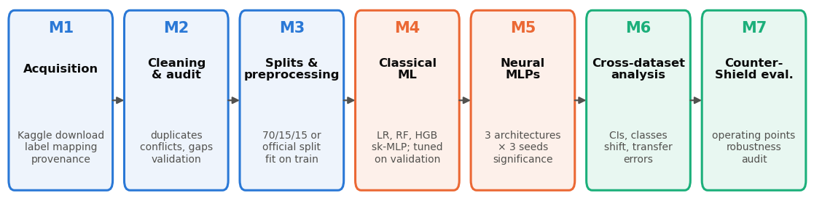
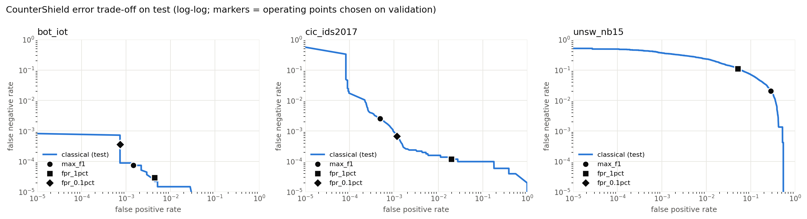
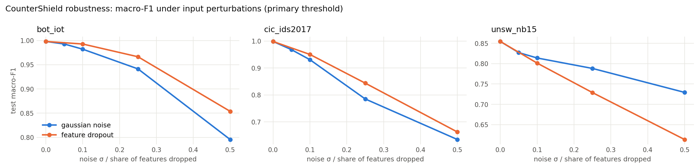

# CounterShield: A Reproducible Multi-Dataset Evaluation of Machine-Learning Network Intrusion Detection under Distribution Shift

[](https://colab.research.google.com/github/Dazedcoder1/CounterShield/blob/main/notebooks/CounterShield_Full_Pipeline.ipynb)
[](LICENSE)
[](https://doi.org/10.5281/zenodo.24256031)

This repository contains the code, configuration files, results, figures and tables for the paper:

> **CounterShield: A Reproducible Multi-Dataset Evaluation of Machine-Learning Network Intrusion Detection under Distribution Shift**<br>
> Shams Tahzib¹, Mohammad Hassan Khan¹, Shailendra Mishra², Megha Rathi¹<br>
> ¹ Department of Computer Science & Engineering and Information Technology, Jaypee Institute of Information Technology, Noida, India<br>
> ² Department of Computer Engineering, College of Computer and Information Sciences, Majmaah University, Al Majmaah, Saudi Arabia<br>
> Submitted to *IEEE Transactions on Network and Service Management*.<br>
> Code and results: [github.com/Dazedcoder1/CounterShield](https://github.com/Dazedcoder1/CounterShield) · archived on Zenodo, [doi:10.5281/zenodo.24256031](https://doi.org/10.5281/zenodo.24256031)

Every number, table and figure in the paper comes from the notebooks in this repository. The notebooks are saved with the outputs of the published run, so the results can be checked without running anything.

## Abstract

Machine-learning network intrusion detection systems (NIDS) reach near-perfect scores on public benchmarks, yet these scores often drop on traffic that differs from the training data. We present CounterShield, a reproducible pipeline that evaluates classical and neural detectors on BoT-IoT, CIC-IDS2017 and UNSW-NB15, with every model, threshold and operating point fixed on validation data. Tree ensembles were selected on all three datasets (a random forest on BoT-IoT and histogram gradient boosting on CIC-IDS2017 and UNSW-NB15) and reached test macro-F1 of 0.9978 on BoT-IoT, 0.9985 on CIC-IDS2017 and 0.8544 on UNSW-NB15. Compared with the selected classical model, the selected PyTorch MLP was significantly worse on BoT-IoT and CIC-IDS2017 and significantly better on UNSW-NB15, by at most 0.010 macro-F1. On UNSW-NB15, a classifier can tell the official test split from the training split (ROC-AUC 0.874); there, the false-positive rate reaches 28.4%, and a threshold chosen for a 1% false-positive rate on validation gives 5.1% on test. Detectors trained on BoT-IoT or UNSW-NB15 and tested on the other rank flows worse than chance (ROC-AUC 0.149–0.346). NIDS evaluations should therefore report shift diagnostics, operating points at fixed false-positive rates and cross-dataset results alongside headline scores.

**Index Terms:** network intrusion detection, machine learning, distribution shift, cross-dataset generalization, operating points, reproducibility.

<p align="center">
  <br>
  <em>Fig. 1. The CounterShield pipeline. Each module reads its inputs from and writes its outputs to Google Drive, records a manifest with SHA-256 hashes, and can be re-run on its own.</em>
</p>

## Contributions

- **A reproducible, audited pipeline** from the raw public datasets to the final results. Cleaning and preprocessing never use test statistics, and an automated audit re-verifies every stored artifact.
- **A controlled comparison** of 4 classical models and 9 PyTorch MLP runs (3 architectures × 3 seeds) per dataset, with paired bootstrap confidence intervals and McNemar tests.
- **Evidence that in-distribution scores are saturated.** The one split with a measurable train/test shift (UNSW-NB15, adversarial ROC-AUC 0.874) loses 0.081 macro-F1 between validation and test, and false-positive targets chosen on validation do not hold on its test set.
- **CounterShield operating points** chosen on validation at maximum macro-F1 and at 1% and 0.1% false-positive rates. They are reported together with alert volumes, missed attack classes and robustness to noise, missing features and threshold drift.

## Main results

**Table IX (excerpt).** Final CounterShield results on the held-out test sets at the maximum-F1 operating point. The detector and threshold were fixed on validation.

| Dataset | Detector | Threshold | Macro-F1 [95% CI] | FPR | FNR |
|---|---|---|---|---|---|
| BoT-IoT | Random forest | 0.660 | 0.9978 [0.9964, 0.9989] | 0.15% | 0.01% |
| CIC-IDS2017 | Hist. gradient boosting | 0.790 | 0.9985 [0.9983, 0.9986] | 0.05% | 0.26% |
| UNSW-NB15 | Hist. gradient boosting | 0.480 | 0.8544 [0.8521, 0.8569] | 28.35% | 2.05% |

**Table V.** PyTorch MLP minus the selected classical model on the test set.

| Dataset | Δ macro-F1 [95% CI] | McNemar *p* |
|---|---|---|
| BoT-IoT | −0.0098 [−0.0128, −0.0072] | 3.5 × 10⁻¹¹ |
| CIC-IDS2017 | −0.0042 [−0.0045, −0.0038] | 1.6 × 10⁻¹²¹ |
| UNSW-NB15 | +0.0045 [+0.0029, +0.0061] | 8.9 × 10⁻⁸ |

Further findings:

- **Distribution shift (Table VII).** Adversarial validation gives ROC-AUC 0.494 on BoT-IoT, 0.502 on CIC-IDS2017 and 0.874 on UNSW-NB15. On UNSW-NB15 the false-positive rate rises from 7.5% on validation to 28.4% on test.
- **Operating points (Table IX, Fig. 4).** The UNSW-NB15 threshold chosen for FPR ≤ 1% on validation gives 5.1% on test. At 10 million benign flows a day, the maximum-F1 operating points correspond to about 4,800 false alerts on CIC-IDS2017-like traffic and 2.8 million on UNSW-NB15-like traffic.
- **Cross-dataset transfer (Table VIII).** On the 8 flow features shared by BoT-IoT and UNSW-NB15, transfer reaches ROC-AUC of only 0.149–0.346, against 0.972 or more in-domain.
- **Robustness (Table X, Fig. 5).** Shifting the threshold by ±0.1 lowers macro-F1 by at most 0.021. Gaussian noise (σ = 0.25) lowers it by up to 0.213, and the CIC-IDS2017 false-negative rate rises from 0.3% to 52.7%.
- **Reproducibility (Table XI).** The audit passed 50 checks with 0 warnings and 0 failures. 27 artifacts are SHA-256 hashed, and 6 reloaded models reproduce their saved test predictions.

<p align="center">
  
  <br>
  <em>Left: Fig. 4, false-negative vs. false-positive rate of CounterShield on test, with the operating points chosen on validation. Right: Fig. 5, test macro-F1 under Gaussian input noise and feature dropout.</em>
</p>

## Datasets

| Dataset | Flows analysed | After cleaning | Attack share | Train / val / test |
|---|---|---|---|---|
| BoT-IoT [1] | 911,828 | 903,922 | 99.0% | 632,744 / 135,589 / 135,589 |
| CIC-IDS2017 [2] | 2,827,876 | 2,198,595 | 15.3% | 1,539,015 / 329,790 / 329,790 |
| UNSW-NB15 [3] | 257,673 | 181,600 | 51.2% | 84,377 / 14,891 / 82,332 (official partition) |

The BoT-IoT input is a stratified sample of the full 73.4 M-flow release: at most 300,000 flows per attack category, seed 42, with all benign and theft flows kept. Raw data is not redistributed here. Module 1 downloads public copies with `kagglehub`, and [`data/README.md`](data/README.md) lists the sources, SHA-256 hashes and label definitions.

## Method summary

| Module | Paper section | What it does |
|---|---|---|
| 1. Dataset acquisition | Sec. III | Downloads the data, harmonises labels (`y_binary`, `y_class`, `y_family`) and hashes every file. |
| 2. Cleaning and audit | Sec. IV-A | Removes identifiers, malformed rows, exact duplicates and conflicting duplicates. |
| 3. Splits and preprocessing | Sec. IV-B | Stratified 70/15/15 splits (UNSW-NB15 keeps its official partition). Median imputation, a quantile transform to a normal distribution and one-hot encoding, all fitted on training data only. |
| 4. Classical models | Sec. IV-C | Logistic regression, random forest (150 trees), histogram gradient boosting and a 128-64 MLP. Selection by validation macro-F1, with the threshold tuned on validation. |
| 5. Neural models | Sec. IV-D | PyTorch MLPs 128-64, 256-128-64 (BatchNorm) and 512-256 (BatchNorm), with seeds 42, 7 and 2026. AdamW, class-weighted BCE, early stopping on validation macro-F1 (patience 6, at most 40 epochs). |
| 6. Generalisation | Sec. IV-G | Validation-to-test gap, adversarial validation, BoT-IoT ↔ UNSW-NB15 transfer and per-class errors. |
| 7. CounterShield evaluation | Sec. IV-E to IV-H | Detector selection (classical, MLP or their average), three operating points, 500-resample bootstrap CIs, paired bootstrap and McNemar tests, robustness tests and the reproducibility audit. |

## Reproducing the paper

1. Open [`notebooks/CounterShield_Full_Pipeline.ipynb`](notebooks/CounterShield_Full_Pipeline.ipynb) in Google Colab, or click the badge above.
2. Add a Kaggle API token as a Colab secret named `KAGGLE_API_TOKEN`.
3. Select a **T4 GPU** runtime. Only Module 5 uses the GPU.
4. Select **Runtime → Run all**. Outputs are written to `MyDrive/CounterShield/`.

A full run takes about 1.5–2 hours. Models are checkpointed, so a re-run reuses them unless `FORCE_RETRAIN = True` is set in Module 4. The modules are also available as standalone notebooks in [`notebooks/modules/`](notebooks/modules). Package versions of the published run (Python 3.13, NVIDIA T4) are listed in [`requirements.txt`](requirements.txt).

### Where each table and figure comes from

| Paper item | File | Source |
|---|---|---|
| Table I: Datasets | [`tables/01_TableI_datasets.csv`](tables/01_TableI_datasets.csv) | Modules 1–3 |
| Table II: Cleaning | [`tables/02_TableII_cleaning.csv`](tables/02_TableII_cleaning.csv) | Module 2 |
| Table III: Validation macro-F1 | [`tables/03_TableIII_validation.csv`](tables/03_TableIII_validation.csv) | Module 4 |
| Table IV: Test performance | [`tables/04_TableIV_test.csv`](tables/04_TableIV_test.csv) | Modules 4–6 |
| Table V: MLP vs. classical | [`tables/05_TableV_mlp_vs_classical.csv`](tables/05_TableV_mlp_vs_classical.csv) | Module 5 |
| Table VI: Weak classes | [`tables/06_TableVI_weak_classes.csv`](tables/06_TableVI_weak_classes.csv) | Module 6 |
| Table VII: Generalisation | [`tables/07_TableVII_generalisation.csv`](tables/07_TableVII_generalisation.csv) | Module 6 |
| Table VIII: Transfer | [`tables/08_TableVIII_transfer.csv`](tables/08_TableVIII_transfer.csv) | Module 6 |
| Table IX: CounterShield | [`tables/09_TableIX_countershield.csv`](tables/09_TableIX_countershield.csv) | Module 7 |
| Table X: Robustness | [`tables/10_TableX_robustness.csv`](tables/10_TableX_robustness.csv) | Module 7 |
| Table XI: Audit | [`tables/11_TableXI_audit.csv`](tables/11_TableXI_audit.csv) | Module 7 |
| Table XII: Model settings | [`tables/12_TableXII_hyperparameters.csv`](tables/12_TableXII_hyperparameters.csv) | Modules 4–5 |
| Fig. 1: Pipeline | [`figures/Fig1_pipeline.png`](figures/Fig1_pipeline.png) | Sec. I |
| Fig. 2: ROC and PR curves | [`figures/Fig2_roc_pr.png`](figures/Fig2_roc_pr.png) | Sec. V-A |
| Fig. 3: Per-class detection | [`figures/Fig3_per_class.png`](figures/Fig3_per_class.png) | Sec. V-C |
| Fig. 4: Operating-point trade-off | [`figures/Fig4_tradeoff.png`](figures/Fig4_tradeoff.png) | Sec. V-E |
| Fig. 5: Robustness | [`figures/Fig5_robustness.png`](figures/Fig5_robustness.png) | Sec. V-F |
| Fig. 6: Confusion matrices | [`figures/Fig6_confusion.png`](figures/Fig6_confusion.png) | Appendix |
| Fig. 7: Classical validation scores | [`figures/Fig7_val_models.png`](figures/Fig7_val_models.png) | Appendix |
| Fig. 8: MLP training curves | [`figures/Fig8_learning.png`](figures/Fig8_learning.png) | Appendix |

Each table is also provided as LaTeX (`.tex`), and [`tables/All_Tables.xlsx`](tables/All_Tables.xlsx) has one sheet per table. Raw per-module outputs are in [`results/`](results), and the settings and split manifests are in [`configs/`](configs).

## Repository layout

```
CounterShield/
├── notebooks/        full pipeline (Modules 1-7) and standalone module notebooks, with outputs
├── figures/          Fig. 1-8 of the paper
├── tables/           Tables I-XII as CSV and LaTeX, plus All_Tables.xlsx
├── results/          raw outputs of Modules 2-7
├── configs/          cleaning, preprocessing and training settings; split manifests
├── data/             dataset provenance and SHA-256 hashes (no raw data)
├── requirements.txt
├── CITATION.cff
├── .zenodo.json
└── LICENSE
```

Model checkpoints, processed data and validation probabilities are not included because the notebook regenerates them.

## Limitations

These are discussed in Sec. VII of the paper:

- **Binary task.** Detection is attack vs. benign; attack families are not modelled.
- **Dataset sources and quality.** The datasets come from public Kaggle copies with recorded hashes. The CIC-IDS2017 labelling errors reported in [4] were not corrected.
- **Cleaning rule.** All conflicting duplicates are removed, and a different rule could change the UNSW-NB15 training set.
- **Limited tuning.** Hyper-parameters were set once per model family, and the classical models use one seed.
- **Transfer scope.** Transfer covers only BoT-IoT and UNSW-NB15, on 8 features whose names match.
- **Synthetic perturbations.** The robustness tests use random noise and feature dropout, not adaptive attacks.

## Citation

If you use this code or these results, please cite the paper:

```bibtex
@article{countershield2026,
  author  = {Tahzib, Shams and Khan, Mohammad Hassan and Mishra, Shailendra and Rathi, Megha},
  title   = {{CounterShield}: A Reproducible Multi-Dataset Evaluation of Machine-Learning Network Intrusion Detection under Distribution Shift},
  journal = {IEEE Transactions on Network and Service Management},
  note    = {Submitted},
  year    = {2026}
}
```

and the software release:

```bibtex
@software{countershield_code_2026,
  author    = {Tahzib, Shams and Khan, Mohammad Hassan and Mishra, Shailendra and Rathi, Megha},
  title     = {{CounterShield}: code and results},
  version   = {1.0.0},
  publisher = {Zenodo},
  doi       = {10.5281/zenodo.24256031},
  url       = {https://github.com/Dazedcoder1/CounterShield},
  year      = {2026}
}
```

Please also cite the original datasets:

1. N. Koroniotis, N. Moustafa, E. Sitnikova and B. Turnbull, "Towards the development of realistic botnet dataset in the Internet of Things for network forensic analytics: Bot-IoT dataset," *Future Generation Computer Systems*, vol. 100, pp. 779–796, 2019, doi: 10.1016/j.future.2019.05.041.
2. I. Sharafaldin, A. H. Lashkari and A. A. Ghorbani, "Toward generating a new intrusion detection dataset and intrusion traffic characterization," in *Proc. 4th Int. Conf. Information Systems Security and Privacy (ICISSP)*, 2018, pp. 108–116, doi: 10.5220/0006639801080116.
3. N. Moustafa and J. Slay, "UNSW-NB15: a comprehensive data set for network intrusion detection systems (UNSW-NB15 network data set)," in *Proc. Military Communications and Information Systems Conf. (MilCIS)*, 2015, pp. 1–6, doi: 10.1109/MilCIS.2015.7348942.
4. G. Engelen, V. Rimmer and W. Joosen, "Troubleshooting an intrusion detection dataset: the CICIDS2017 case study," in *Proc. IEEE Security and Privacy Workshops (SPW)*, 2021, pp. 7–12, doi: 10.1109/SPW53761.2021.00009.

## License

The code is released under the [MIT License](LICENSE). The datasets remain under their original licences and terms of use.
